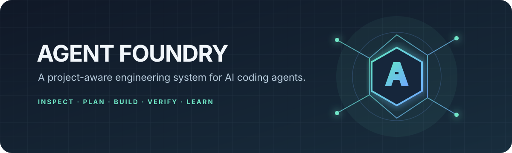
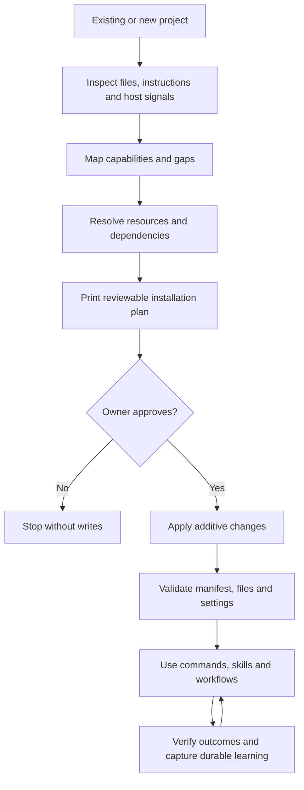

<div align="center">



# Agent Foundry

### A reusable engineering environment for AI coding agents.

**One project. Consistent engineering habits. Better continuity across agents and sessions.**

[](https://github.com/LemonizDev/Agent-Foundry/actions/workflows/ci.yml)
[](LICENSE)
[](https://nodejs.org/)

[Quick start](#quick-start) · [How it works](#how-it-works) · [CLI reference](#cli-reference) · [Commands](docs/COMMAND_CATALOG.md) · [Documentation](docs/README.md) · [Contributing](CONTRIBUTING.md)

</div>

---

## What Agent Foundry does

AI coding agents can generate code. Reliable engineering across a real repository is harder: agents need project context, consistent procedures, explicit permissions, accountable delegation, repeatable verification and a way to preserve important discoveries between sessions.

Agent Foundry is a **resource library and project-integration CLI**. It helps a project adopt a reusable engineering system without replacing its existing architecture or instructions.

- **Project-aware onboarding:** inspect a repository, identify existing capabilities and propose relevant additions.
- **Shared operating baseline:** compact instructions backed by standards for safety, communication, context and evidence.
- **Reusable engineering commands:** audit, implement, debug, review, verify, delegate, report progress and recover interrupted work.
- **Skills and workflows:** detailed procedures behind commands and coordinated multi-step work.
- **Model-aware recommendations:** classify tasks and recommend from a model roster controlled by the project owner.
- **Managed lifecycle:** plan-first installation, manifest-based ownership, validation, update previews and cautious uninstall.
- **Host adapters:** generate host-shaped instruction, skill, command and profile files where adapters provide mappings.

Foundry does not provide the model, IDE, agent runtime, process sandbox or provider dispatch. The host controls model access, tools, permissions and execution. A generated file is not proof that a host loads or executes it correctly.

## Quick start

**Requirements:** Node.js 20 or newer. Run from the root of the project you want to configure.

### 1. Inspect and preview

```bash
npx --yes --package github:LemonizDev/Agent-Foundry agent-foundry init
```

This is plan-only by default. It inspects the project and prints proposed resources, host artifacts, conflicts and entrypoint changes. It does not write files.

### 2. Review, then apply

```bash
npx --yes --package github:LemonizDev/Agent-Foundry agent-foundry init --preset auto --apply
```

The CLI asks for explicit confirmation. Use `--yes` only when the surrounding automation has already obtained approval.

### 3. Validate

```bash
npx --yes --package github:LemonizDev/Agent-Foundry agent-foundry validate
```

Review `.agent-foundry/README.md`, the generated entrypoint and manifest. The project owner remains responsible for deciding which host capabilities are enabled.

> **Development build:** v0.5 is under development, not a stable release. Until a tagged release exists, the GitHub package invocation targets the repository's default branch. For reproducible use, pin a reviewed commit with the source-ref options and record that revision.

### Existing projects are first-class

Foundry should inspect existing instructions, architecture and tools, then recommend gaps. It must not replace an existing `AGENTS.md`, `CLAUDE.md`, architecture document or local convention merely because a preset includes a similar resource. If a plan shows a conflict, stop and inspect it. `--skip-conflicts` leaves an existing path untouched; it is not an automatic merge.

## How it works



### The resource model

| Resource | Purpose | Example |
|---|---|---|
| Core instructions | Small always-read operating contract | Inspect before editing; preserve work; verify claims |
| Standards | Rules that apply across tasks | Security, evidence quality, context management |
| Commands | User-facing entrypoints | `/implement`, `/debug`, `/review`, `/close` |
| Skills | Detailed task procedures | Debugging, repository audit, session learning |
| Workflows | Multi-step coordination | Multi-agent campaign, session close |
| Profiles | Specialist responsibilities | Lead engineer, independent reviewer |
| Templates | Consistent records and outputs | Delegation assignment, decision register |
| Integrations | Host-specific file generation | Skills, commands and agent profiles |

**A command is the request. A skill is the procedure. A workflow coordinates several procedures.** Keeping these layers separate prevents every command becoming a giant duplicated prompt.

## Using Foundry day to day

The portable command contracts live in `commands/`. A host may expose them as native slash commands, prompt shortcuts, workflows or named skills. A Markdown contract alone does not prove a native slash command exists.

| Request | Command | Expected result |
|---|---|---|
| Understand the repository and its gaps | `/audit` | Read-only findings with scope and evidence |
| Implement an approved change | `/implement` | Bounded implementation with incremental verification |
| Investigate a failure | `/debug` | Reproduction, tested hypotheses and root cause |
| Challenge a change before merging | `/review` | Findings first, severity and evidence |
| Prove acceptance criteria | `/verify` | Verification matrix with exact outcomes |
| Split work safely | `/delegate` | Bounded assignment, ownership and checkpoints |
| See real progress | `/progress-report` | Evidence-backed status, not activity estimates |
| Choose the next useful action | `/next-task` | One prioritised action tied to risk and dependencies |
| Recover interrupted work | `/resume` | Reconciled repository state and last verified checkpoint |
| Close a session responsibly | `/close` | Durable learning routed to canonical project files |

See the [full command catalog](docs/COMMAND_CATALOG.md) for inputs, permissions, execution rules, output contracts and failure behaviour.

## Model recommendations

The project owner defines available models in `.agent-foundry/settings/model-roster.yaml`. Foundry classifies a task, checks required capabilities and constraints, then recommends an eligible model with a rationale.

It does **not** call model providers, launch subagents or guarantee that a host can switch models automatically. If the host cannot perform the recommended action, the result is guidance for the owner, not a claim of dispatch.

## Presets

Presets are starting bundles, not mandatory architectures. Review the actual plan before applying one.

| Preset | Intended fit |
|---|---|
| `minimal` | Compact baseline for essential operating practices |
| `balanced` | Common engineering procedures, commands and verification |
| `autonomous-engineer` | Delegation, recovery, planning and stronger quality gates |
| `visual-engineer` | Engineering baseline plus graphics, rendering and visual QA |
| `research-engineer` | Research-oriented workflows and privacy-aware evidence |
| `auto` | Autonomous-engineer baseline plus visual resources when project signals indicate graphics work |

The scanner uses repository signals and heuristics. It is not a semantic guarantee that it understands the product. Review the capability assessment and resource list.

## CLI reference

All project commands accept `--project PATH`.

| Command | Purpose |
|---|---|
| `init` | Inspect and create a plan; use `--apply` to install |
| `inspect` | Print project signals, detected hosts and capability assessment |
| `list` | List resources in the selected registry |
| `validate` | Validate an installed Foundry project |
| `update` | Preview updates; use `--apply` after reviewing |
| `uninstall` | Preview removal; use `--apply` and confirm |
| `route --task "…"` | Recommend a model from the project's roster |
| `settings` | Show configuration file locations |
| `version` | Print CLI version |
| `help` | Show usage |

Common options: `--preset NAME`, `--resources id,id`, `--hosts host,host`, `--repository OWNER/NAME`, `--ref REF`, `--apply`, `--yes`, `--skip-conflicts`. Check the installed CLI's `help` output for the exact supported combination.

## Installation layout

The exact files depend on selected resources and detected hosts. A typical project includes:

```text
your-project/
├── AGENTS.md                         # Created or extended additively
├── CLAUDE.md                         # Only when Claude Code is detected
└── .agent-foundry/
    ├── manifest.json                 # Source revision and managed hashes
    ├── instructions.md               # Compact project entrypoint
    ├── settings/
    │   ├── foundry-settings.yaml     # Project-owned policies
    │   └── model-roster.yaml         # Models selected by the owner
    ├── resources/                    # Selected canonical resources
    ├── overrides/                    # Project-specific customisations
    └── README.md                     # Installation and maintenance notes
```

Foundry's source repository layout differs from the installed project layout. See [Engine Architecture](architecture/ENGINE_ARCHITECTURE.md).

## Safety and ownership

- Plan before write. `init` is read-only unless `--apply` is supplied.
- Existing files are not silently overwritten.
- Managed files are tracked in a project-local manifest with hashes.
- Updates compare local content before proposing changes.
- Uninstall removes only unchanged Foundry-owned content and preserves owner modifications.
- Paths are checked for traversal and symlink hazards.
- Secrets do not belong in model roster files or generated documentation.

These protections reduce accidental damage; they do not make Foundry a security sandbox. Review filesystem permissions, host tool permissions and autonomous execution policy separately. Read the [security policy](SECURITY.md).

## Host compatibility: generation is not acceptance

| Evidence level | What it proves |
|---|---|
| Format generated | Adapter emitted a file in the expected shape |
| Structure validated | Required metadata and paths pass automated checks |
| Discovery tested | A named host version actually discovers the file |
| Invocation tested | The host can invoke the command or skill |
| Behaviour accepted | A real task completed with expected behaviour and documented limits |

Do not describe a host as fully supported until discovery and invocation have been tested against a stated host version. Unit tests for generated text do not prove runtime compatibility.

## Project maturity

v0.5 is a development milestone, not a stable production-certified agent runtime.

| Area | Current position |
|---|---|
| Node.js CLI and resource registry | Implemented; automated validation exists |
| Plan-first installer and managed lifecycle | Implemented; edge cases remain a release gate |
| Host artifact generation | Implemented; native runtime acceptance remains incomplete |
| Model classification and recommendation | Implemented; no provider dispatch |
| Resource library | Expanding; resources remain draft until scenario-validated |
| Cross-platform CI | Configured; release candidates must pass the actual matrix |
| Stable npm release | Not published by this development branch |

A capability moves from draft to validated only when acceptance evidence is recorded. Documentation is not implementation, generated artifacts are not host acceptance, and passing unit tests are not production readiness.

## Contributing

1. Read [CONTRIBUTING.md](CONTRIBUTING.md) and the [resource authoring standard](standards/RESOURCE_AUTHORING_STANDARD.md).
2. Keep changes scoped and preserve unrelated work.
3. Run `npm ci`, `npm test` and `npm run validate:repo`.
4. Explain the behaviour changed and provide evidence for each claim.
5. Update the changelog and relevant docs when user-facing behaviour changes.

## Documentation map

- [User Guide](docs/USER_GUIDE.md): concepts, setup, presets and lifecycle.
- [Command Catalog](docs/COMMAND_CATALOG.md): command inputs, permissions and outputs.
- [Engine Architecture](docs/architecture/ENGINE_ARCHITECTURE.md): implementation boundaries.
- [Existing Project Integration](docs/architecture/EXISTING_PROJECT_INTEGRATION.md): additive migration design.
- [Model Delegation](docs/architecture/MODEL_DELEGATION.md): task classification and roster logic.
- [Distribution and Versioning](docs/architecture/DISTRIBUTION_AND_VERSIONING.md): package and release model.
- [Release Readiness](docs/RELEASE_CHECKLIST.md): evidence required before tagging.
- [Resource Registry](registry/resources.yaml): machine-readable resource catalog.
- [Documentation Index](docs/README.md): complete navigation.
- [Changelog](CHANGELOG.md): repository history.

---

<div align="center">

**Agent Foundry**
*Make your agent better at working on your project, not just better at generating code.*

</div>
