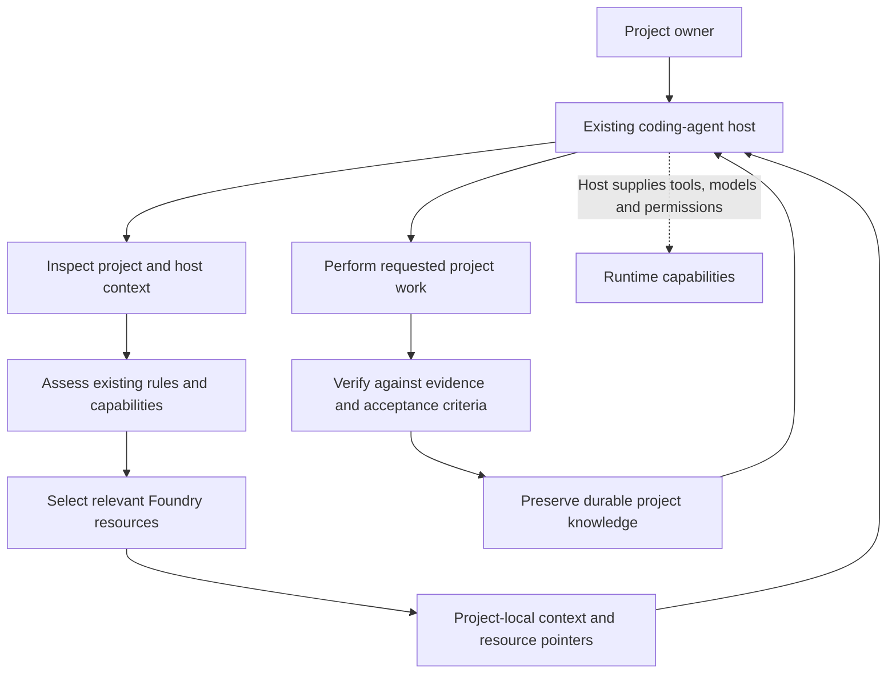
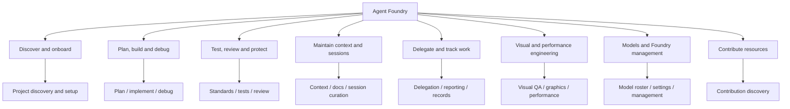
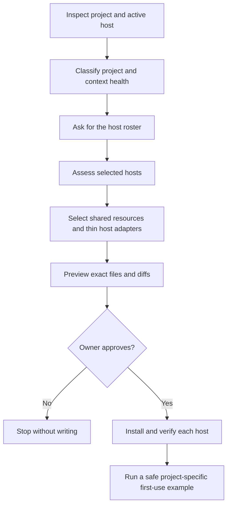

<div align="center">


# Agent Foundry

### A project-aware resource system for the AI coding agent you already use.

**Agent Foundry helps coding agents understand a project, follow repeatable engineering practices, preserve useful context and coordinate work without replacing the host app or model.**

[](https://github.com/LemonizDev/Agent-Foundry/actions/workflows/ci.yml)
[](CHANGELOG.md)
[](LICENSE)

</div>

## Contents

- [About Agent Foundry](#about-agent-foundry)
- [The problem it solves](#the-problem-it-solves)
- [How it works](#how-it-works)
- [What you get](#what-you-get)
- [Feature menu](#feature-menu)
- [Project-aware installation](#project-aware-installation)
- [Coding-agent apps](#coding-agent-apps)
- [Usage and examples](#usage-and-examples)
- [Configuration and management](#configuration-and-management)
- [Documentation and support](#documentation-and-support)
- [Community contributions](#community-contributions)
- [Security and boundaries](#security-and-boundaries)
- [License](#license)

## About Agent Foundry

Agent Foundry is a **reusable context and workflow library for AI coding agents**. It provides project instructions, engineering standards, task skills, user-facing command contracts, workflows, specialist profiles, templates and host-integration guidance.

It is designed for people who already use coding-agent apps such as Codex, Claude Code, OpenCode, Kilo, Cline, Cursor, Windsurf or GitHub Copilot. Keep the agent and model you prefer; Foundry supplies reusable project practices that the agent can inspect and apply when relevant.

Foundry is not another coding agent, an IDE, a model provider, a daemon, a CLI installer or a security sandbox. The consuming host remains responsible for model access, tools, filesystem/network permissions, command execution and any subagent capability.

## The problem it solves

AI coding agents often start each task with incomplete or scattered context. Project rules may be duplicated across files, architecture knowledge can be difficult to locate, and useful procedures get buried in old conversations. Large instruction files create prompt overhead, while copying every available skill into every project creates clutter.

Agent Foundry addresses this by making reusable practices discoverable and project-aware:

- **Inspect before installing:** preserve instructions, tools and workflows that already work.
- **One source of truth:** link to canonical project context instead of duplicating it.
- **Progressive disclosure:** keep the core small and bring in specialist procedures only when relevant and supported by the host.
- **Repeatable execution:** use clear task contracts, acceptance criteria, checkpoints and verification.
- **Durable continuity:** preserve decisions and useful lessons without dumping transcripts into the repository.

## How it works

Foundry is a collection of files, not a separate runtime. Your coding-agent host reads the project context, consults selected Foundry resources and performs work using its own capabilities.



A Foundry installation is a **small, approved selection**, not a wholesale copy of the registry. Existing project instructions remain authoritative unless the owner explicitly approves an additive change.

## What you get

| Capability | Practical value |
|---|---|
| Project-aware onboarding | Fit the resource set to the project you actually have. |
| Skills and workflows | Reusable methods for planning, implementation, debugging, testing and review. |
| Session continuity | Keep verified decisions, blockers and next actions discoverable. |
| Delegation contracts | Make multi-agent work more bounded and accountable where the host supports it. |
| Documentation practices | Reduce stale context and competing sources of truth. |
| Multi-host adaptation | Share project-local resources across selected coding-agent apps with thin host-specific pointers. |
| Owner-controlled lifecycle | Preview changes, preserve local edits and maintain an ownership manifest. |

## Feature menu

Start with a goal, open its resource family, then open the specific resource for its purpose, usage and canonical source. This catalogue is generated from the [resource registry](registry/resources.yaml).

### Feature map



<details>
<summary><strong>01 · Discover and onboard a project</strong></summary>

Understand a codebase, assess its current practices and integrate Foundry without replacing existing project rules.

<details>
<summary>Project discovery</summary>

<details>
<summary><strong>Commands (2)</strong></summary>

<details>
<summary>Audit</summary>

Runs a read-only, evidence-based repository audit.

**What it does**  
Runs a read-only, evidence-based repository audit.

**How to use it**  
`/audit [scope]`

**Example**  
`/audit scope: authentication`<br>Map the auth flow, existing tests and risks. Do not change files.

**Expected result**  
A scoped project map, prioritised findings and an evidence-backed next action.

[Open full resource](../commands/audit.md)

</details>

<details>
<summary>Project Health</summary>

Assesses project health across architecture, quality, security, operations and continuity.

**What it does**  
Assesses project health across architecture, quality, security, operations and continuity.

**How to use it**  
`/project-health [project or subsystem]`

**Expected result**  
A health assessment across architecture, quality, security, operations and continuity.

[Open full resource](../commands/project-health.md)

</details>

</details>

<details>
<summary><strong>Skills (2)</strong></summary>

<details>
<summary>Host Roster Onboarding</summary>

Discovers the user's active and additional coding-agent hosts, then plans safe multi-host project integration with per-host verification.

**When to use it**  
When the task needs this procedure: discovers the user's active and additional coding-agent hosts, then plans safe multi-host project integration with per-host verification.

**How to request it**  
Ask your coding agent to use **Host Roster Onboarding** for the current task. Automatic discovery depends on the selected host.

[Open full resource](../skills/host-roster-onboarding/SKILL.md)

</details>

<details>
<summary>Repository Audit</summary>

Maps repository structure, runtime flows, authoritative context, quality controls and evidence-backed gaps.

**When to use it**  
When the task needs this procedure: maps repository structure, runtime flows, authoritative context, quality controls and evidence-backed gaps.

**How to request it**  
Ask your coding agent to use **Repository Audit** for the current task. Automatic discovery depends on the selected host.

[Open full resource](../skills/repository-audit/SKILL.md)

</details>

</details>

<details>
<summary><strong>Workflows (1)</strong></summary>

<details>
<summary>Existing Project Integration</summary>

Assesses an established repository and adds only relevant Foundry resources without replacing its architecture.

**Use it when**  
The work needs coordinated stages, dependencies, handoffs or explicit quality gates.

[Open full resource](../docs/architecture/EXISTING_PROJECT_INTEGRATION.md)

</details>

</details>

<details>
<summary><strong>Core instructions (1)</strong></summary>

<details>
<summary>Global Instructions</summary>

Compact, project-agnostic operating instructions that connect installed standards, task resources and Foundry management triggers into one agent entrypoint.

**Reference**  
Compact, project-agnostic operating instructions that connect installed standards, task resources and Foundry management triggers into one agent entrypoint.

[Open full resource](../core/GLOBAL_INSTRUCTIONS.md)

</details>

</details>

<details>
<summary><strong>Documentation (1)</strong></summary>

<details>
<summary>Context Architecture</summary>

Documents the context-first architecture: context-file hierarchy, progressive disclosure, conversational management and current limitations.

**Reference**  
Documents the context-first architecture: context-file hierarchy, progressive disclosure, conversational management and current limitations.

[Open full resource](../docs/architecture/CONTEXT_ARCHITECTURE.md)

</details>

</details>

</details>

<details>
<summary>Getting started and guidance</summary>

<details>
<summary><strong>Documentation (1)</strong></summary>

<details>
<summary>User Guide</summary>

Explains Agent Foundry setup, chat-native management, commands, resource types, presets, delegation and maintenance.

**Reference**  
Explains Agent Foundry setup, chat-native management, commands, resource types, presets, delegation and maintenance.

[Open full resource](../docs/USER_GUIDE.md)

</details>

</details>

</details>

</details>

<details>
<summary><strong>02 · Plan, build and debug</strong></summary>

Turn an intended change into bounded work, implement it safely and investigate failures.

<details>
<summary>Plan and design</summary>

<details>
<summary><strong>Commands (1)</strong></summary>

<details>
<summary>Next Task</summary>

Recommends the highest-value next engineering action from current evidence and dependencies.

**What it does**  
Recommends the highest-value next engineering action from current evidence and dependencies.

**How to use it**  
`/next-task [milestone or workstream]`

**Expected result**  
One recommended next action with rationale and acceptance criteria.

[Open full resource](../commands/next-task.md)

</details>

</details>

<details>
<summary><strong>Skills (2)</strong></summary>

<details>
<summary>Implementation Planning</summary>

Turns desired outcomes into bounded tasks with dependencies, acceptance criteria and verification.

**When to use it**  
When the task needs this procedure: turns desired outcomes into bounded tasks with dependencies, acceptance criteria and verification.

**How to request it**  
Ask your coding agent to use **Implementation Planning** for the current task. Automatic discovery depends on the selected host.

[Open full resource](../skills/implementation-planning/SKILL.md)

</details>

<details>
<summary>Architecture Design</summary>

Designs maintainable system boundaries and decisions grounded in requirements and tradeoffs.

**When to use it**  
When the task needs this procedure: designs maintainable system boundaries and decisions grounded in requirements and tradeoffs.

**How to request it**  
Ask your coding agent to use **Architecture Design** for the current task. Automatic discovery depends on the selected host.

[Open full resource](../skills/architecture-design/SKILL.md)

</details>

</details>

<details>
<summary><strong>Standards (2)</strong></summary>

<details>
<summary>Engineering Principles</summary>

Universal engineering baseline for understanding before changing, preserving project intent, incremental implementation and evidence-based completion.

**Scope**  
A reusable rule for the relevant tasks. Follow the project's own authority hierarchy where it is stricter.

[Open full resource](../standards/engineering-principles.md)

</details>

<details>
<summary>Decision Making</summary>

Provides an evidence-based procedure for comparing options, recording tradeoffs and escalating owner decisions.

**Scope**  
A reusable rule for the relevant tasks. Follow the project's own authority hierarchy where it is stricter.

[Open full resource](../standards/decision-making.md)

</details>

</details>

</details>

<details>
<summary>Build and explain</summary>

<details>
<summary><strong>Commands (2)</strong></summary>

<details>
<summary>Implement</summary>

Executes an approved implementation plan with incremental verification.

**What it does**  
Executes an approved implementation plan with incremental verification.

**How to use it**  
`/implement [feature, bug or approved plan]`

**Example**  
`/implement the approved retry policy`<br>Follow the agreed scope and verify each acceptance criterion.

**Expected result**  
Delivered behaviour, files changed, verification evidence, limitations and remaining risks.

[Open full resource](../commands/implement.md)

</details>

<details>
<summary>Teach Implementation</summary>

Explains a completed implementation in a structured, project-relevant way.

**What it does**  
Explains a completed implementation in a structured, project-relevant way.

**How to use it**  
`/teach-implementation [change-or-feature]`

**Expected result**  
An explanation of changed files, runtime behaviour, trade-offs and verification.

[Open full resource](../commands/teach-implementation.md)

</details>

</details>

<details>
<summary><strong>Skills (2)</strong></summary>

<details>
<summary>Atomic Implementation</summary>

Guides small, bounded implementation steps with clear acceptance criteria and verification.

**When to use it**  
When the task needs this procedure: guides small, bounded implementation steps with clear acceptance criteria and verification.

**How to request it**  
Ask your coding agent to use **Atomic Implementation** for the current task. Automatic discovery depends on the selected host.

[Open full resource](../skills/atomic-implementation/SKILL.md)

</details>

<details>
<summary>Implementation Explanation</summary>

Explains code changes, their runtime behaviour, tradeoffs and verification evidence.

**When to use it**  
When the task needs this procedure: explains code changes, their runtime behaviour, tradeoffs and verification evidence.

**How to request it**  
Ask your coding agent to use **Implementation Explanation** for the current task. Automatic discovery depends on the selected host.

[Open full resource](../skills/implementation-explanation/SKILL.md)

</details>

</details>

</details>

<details>
<summary>Debug</summary>

<details>
<summary><strong>Commands (1)</strong></summary>

<details>
<summary>Debug</summary>

Investigates a reproducible failure and isolates its root cause.

**What it does**  
Investigates a reproducible failure and isolates its root cause.

**How to use it**  
`/debug [symptom, error or failing behaviour]`

**Expected result**  
A reproducible cause, supporting evidence and the smallest safe fix or next experiment.

[Open full resource](../commands/debug.md)

</details>

</details>

<details>
<summary><strong>Skills (1)</strong></summary>

<details>
<summary>Debugging</summary>

Diagnoses failures through reproducible experiments and root-cause analysis.

**When to use it**  
When the task needs this procedure: diagnoses failures through reproducible experiments and root-cause analysis.

**How to request it**  
Ask your coding agent to use **Debugging** for the current task. Automatic discovery depends on the selected host.

[Open full resource](../skills/debugging/SKILL.md)

</details>

</details>

</details>

</details>

<details>
<summary><strong>03 · Test, review and protect</strong></summary>

Verify outcomes against criteria, review independently and protect project data and execution boundaries.

<details>
<summary>Standards and procedures</summary>

<details>
<summary><strong>Skills (4)</strong></summary>

<details>
<summary>Testing And Verification</summary>

Selects risk-based tests and reports exactly what was and was not verified.

**When to use it**  
When the task needs this procedure: selects risk-based tests and reports exactly what was and was not verified.

**How to request it**  
Ask your coding agent to use **Testing And Verification** for the current task. Automatic discovery depends on the selected host.

[Open full resource](../skills/testing-and-verification/SKILL.md)

</details>

<details>
<summary>Code Review</summary>

Performs independent, findings-first review of code changes, risks and test quality.

**When to use it**  
When the task needs this procedure: performs independent, findings-first review of code changes, risks and test quality.

**How to request it**  
Ask your coding agent to use **Code Review** for the current task. Automatic discovery depends on the selected host.

[Open full resource](../skills/code-review/SKILL.md)

</details>

<details>
<summary>Privacy Safe Evidence</summary>

Collects and reports useful evidence while minimising secrets, personal data and sensitive project details.

**When to use it**  
When the task needs this procedure: collects and reports useful evidence while minimising secrets, personal data and sensitive project details.

**How to request it**  
Ask your coding agent to use **Privacy Safe Evidence** for the current task. Automatic discovery depends on the selected host.

[Open full resource](../skills/privacy-safe-evidence/SKILL.md)

</details>

<details>
<summary>Agent Execution Security</summary>

Assesses permissions, isolation, secrets exposure and risks from autonomous agent execution.

**When to use it**  
When the task needs this procedure: assesses permissions, isolation, secrets exposure and risks from autonomous agent execution.

**How to request it**  
Ask your coding agent to use **Agent Execution Security** for the current task. Automatic discovery depends on the selected host.

[Open full resource](../skills/agent-execution-security/SKILL.md)

</details>

</details>

<details>
<summary><strong>Standards (2)</strong></summary>

<details>
<summary>Security Boundaries</summary>

Sets least-privilege, secret-handling, untrusted-input and approval boundaries for AI-assisted engineering.

**Scope**  
A reusable rule for the relevant tasks. Follow the project's own authority hierarchy where it is stricter.

[Open full resource](../standards/security-boundaries.md)

</details>

<details>
<summary>Evidence And Verification</summary>

Sets rules for evidence quality, verification claims and explicit unverified or blocked states.

**Scope**  
A reusable rule for the relevant tasks. Follow the project's own authority hierarchy where it is stricter.

[Open full resource](../standards/evidence-and-verification.md)

</details>

</details>

</details>

<details>
<summary>Review and verification</summary>

<details>
<summary><strong>Commands (2)</strong></summary>

<details>
<summary>Review</summary>

Runs an independent, read-only engineering review.

**What it does**  
Runs an independent, read-only engineering review.

**How to use it**  
`/review [diff, commit, feature or scope]`

**Example**  
`/review current diff`<br>Return findings first, with evidence and severity.

**Expected result**  
Findings first, reviewed/unreviewed areas, test gaps and overall risk.

[Open full resource](../commands/review.md)

</details>

<details>
<summary>Verify</summary>

Checks acceptance criteria against explicit test and runtime evidence.

**What it does**  
Checks acceptance criteria against explicit test and runtime evidence.

**How to use it**  
`/verify [change, milestone or acceptance criteria]`

**Expected result**  
A criterion-by-criterion PASS / FAIL / BLOCKED / NOT RUN result with evidence.

[Open full resource](../commands/verify.md)

</details>

</details>

<details>
<summary><strong>Templates (1)</strong></summary>

<details>
<summary>Test Evidence Report</summary>

Records verification commands, environments, outcomes, coverage and unresolved checks.

**Use it for**  
A consistent record or output for this purpose. Fill only fields supported by project evidence.

[Open full resource](../templates/test-evidence-report.md)

</details>

</details>

</details>

<details>
<summary>Specialist review</summary>

<details>
<summary><strong>Specialist profiles (1)</strong></summary>

<details>
<summary>Independent Reviewer</summary>

Defines a sceptical, findings-first reviewer role that challenges implementation and evidence.

**Responsibility**  
Defines the role and its expected focus.

**Boundary**  
A profile describes responsibility; it does not grant tools, permissions or independent runtime access.

[Open full resource](../profiles/independent-reviewer.md)

</details>

</details>

</details>

</details>

<details>
<summary><strong>04 · Maintain context and finish sessions</strong></summary>

Keep project knowledge coherent and decide what is worth saving from a productive conversation.

<details>
<summary>Context and documentation standards</summary>

<details>
<summary><strong>Skills (2)</strong></summary>

<details>
<summary>Project State Management</summary>

Maintains canonical project context, current state, blockers and next actions without duplicating sources of truth.

**When to use it**  
When the task needs this procedure: maintains canonical project context, current state, blockers and next actions without duplicating sources of truth.

**How to request it**  
Ask your coding agent to use **Project State Management** for the current task. Automatic discovery depends on the selected host.

[Open full resource](../skills/project-state-management/SKILL.md)

</details>

<details>
<summary>Documentation Maintenance</summary>

Keeps project documentation accurate, navigable and free of competing sources of truth.

**When to use it**  
When the task needs this procedure: keeps project documentation accurate, navigable and free of competing sources of truth.

**How to request it**  
Ask your coding agent to use **Documentation Maintenance** for the current task. Automatic discovery depends on the selected host.

[Open full resource](../skills/documentation-maintenance/SKILL.md)

</details>

</details>

<details>
<summary><strong>Standards (3)</strong></summary>

<details>
<summary>Agent Communication</summary>

Defines clear owner communication, progress reporting, uncertainty labels and approval gates.

**Scope**  
A reusable rule for the relevant tasks. Follow the project's own authority hierarchy where it is stricter.

[Open full resource](../standards/agent-communication.md)

</details>

<details>
<summary>Context Management</summary>

Defines canonical project context, progressive disclosure and durable session learning without transcript dumps.

**Scope**  
A reusable rule for the relevant tasks. Follow the project's own authority hierarchy where it is stricter.

[Open full resource](../standards/context-management.md)

</details>

<details>
<summary>Documentation Governance</summary>

Defines documentation ownership, source-of-truth hierarchy, lifecycle and navigation rules.

**Scope**  
A reusable rule for the relevant tasks. Follow the project's own authority hierarchy where it is stricter.

[Open full resource](../standards/documentation-governance.md)

</details>

</details>

</details>

<details>
<summary>README design and navigation</summary>

<details>
<summary><strong>Skills (2)</strong></summary>

<details>
<summary>Readme Maker</summary>

Creates and maintains concise, navigable GitHub READMEs with nested feature trees, accessible visual hierarchy and validated resource links.

**When to use it**  
When the task needs this procedure: creates and maintains concise, navigable GitHub READMEs with nested feature trees, accessible visual hierarchy and validated resource links.

**How to request it**  
Ask your coding agent to use **Readme Maker** for the current task. Automatic discovery depends on the selected host.

[Open full resource](../skills/readme-maker/SKILL.md)

</details>

<details>
<summary>Feature Menu Architect</summary>

Inspects a project and plans a user-goal-led feature menu with classified resource types, Mermaid hierarchy diagrams and resource-level usage panels.

**When to use it**  
When the task needs this procedure: inspects a project and plans a user-goal-led feature menu with classified resource types, Mermaid hierarchy diagrams and resource-level usage panels.

**How to request it**  
Ask your coding agent to use **Feature Menu Architect** for the current task. Automatic discovery depends on the selected host.

[Open full resource](../skills/feature-menu-architect/SKILL.md)

</details>

</details>

<details>
<summary><strong>Templates (1)</strong></summary>

<details>
<summary>Readme Template</summary>

Provides an adaptable project-first README structure with manual navigation, overview, architecture, installation, usage, documentation and contribution sections.

**Use it for**  
A consistent record or output for this purpose. Fill only fields supported by project evidence.

[Open full resource](../templates/README_TEMPLATE.md)

</details>

</details>

</details>

<details>
<summary>Session learning and recovery</summary>

<details>
<summary><strong>Commands (3)</strong></summary>

<details>
<summary>Close Session</summary>

Preserves durable project context at session end without creating transcript dumps or new reusable resource types.

**What it does**  
Preserves durable project context at session end without creating transcript dumps or new reusable resource types.

**How to use it**  
`/close, /close session, /close chat`

**Example**  
`/close`<br>Capture durable project decisions and verified lessons without creating a new resource.

**Expected result**  
Durable context captured, files updated and unresolved questions.

**Choose this when:** you want durable project decisions, verified lessons and stable context retained. It should not invent a new reusable resource.

[Open full resource](../commands/close-session.md)

</details>

<details>
<summary>Done</summary>

Ends a productive session by classifying and saving worthwhile reusable project resources, and rejects the operation without writing when nothing qualifies.

**What it does**  
Ends a productive session by classifying and saving worthwhile reusable project resources, and rejects the operation without writing when nothing qualifies.

**How to use it**  
`/done`

**Example**  
`/done`<br>Inspect this session for worthwhile reusable project resources. Save only items that meet the quality bar; reject an empty session.

**Expected result**  
Accepted resource type(s) and destinations, or explicit rejection with no files written.

**Strict acceptance rule:** only create a resource when the session contains a complete, reusable project artefact. If nothing qualifies, say so and write nothing. `/close` remains the context-continuity command.

[Open full resource](../commands/done.md)

</details>

<details>
<summary>Resume</summary>

Recovers interrupted work from durable checkpoints and verified repository state.

**What it does**  
Recovers interrupted work from durable checkpoints and verified repository state.

**How to use it**  
`/resume [task or milestone]`

**Expected result**  
Verified current state, recovery point, unresolved work and next action.

[Open full resource](../commands/resume.md)

</details>

</details>

<details>
<summary><strong>Skills (3)</strong></summary>

<details>
<summary>Session Learning</summary>

Extracts durable, actionable project knowledge from a session and updates its proper context source.

**When to use it**  
When the task needs this procedure: extracts durable, actionable project knowledge from a session and updates its proper context source.

**How to request it**  
Ask your coding agent to use **Session Learning** for the current task. Automatic discovery depends on the selected host.

[Open full resource](../skills/session-learning/SKILL.md)

</details>

<details>
<summary>Session Resource Curation</summary>

Applies a strict quality bar to reusable artefacts from a chat session, classifies them by resource type and stores qualified material in canonical project locations.

**When to use it**  
When the task needs this procedure: applies a strict quality bar to reusable artefacts from a chat session, classifies them by resource type and stores qualified material in canonical project locations.

**How to request it**  
Ask your coding agent to use **Session Resource Curation** for the current task. Automatic discovery depends on the selected host.

[Open full resource](../skills/session-resource-curation/SKILL.md)

</details>

<details>
<summary>Session Recovery</summary>

Reconciles interrupted work against repository state and resumes from verified checkpoints.

**When to use it**  
When the task needs this procedure: reconciles interrupted work against repository state and resumes from verified checkpoints.

**How to request it**  
Ask your coding agent to use **Session Recovery** for the current task. Automatic discovery depends on the selected host.

[Open full resource](../skills/session-recovery/SKILL.md)

</details>

</details>

<details>
<summary><strong>Workflows (1)</strong></summary>

<details>
<summary>Session Close</summary>

Coordinates the review, consolidation and verification of durable session learnings.

**Use it when**  
The work needs coordinated stages, dependencies, handoffs or explicit quality gates.

[Open full resource](../workflows/session-close.md)

</details>

</details>

<details>
<summary><strong>Templates (1)</strong></summary>

<details>
<summary>Decision Register</summary>

Records architectural and product decisions, alternatives, rationale and consequences.

**Use it for**  
A consistent record or output for this purpose. Fill only fields supported by project evidence.

[Open full resource](../templates/decision-register.md)

</details>

</details>

</details>

</details>

<details>
<summary><strong>05 · Delegate and track work</strong></summary>

Coordinate work across agents or people, preserve checkpoints and report progress from evidence.

<details>
<summary>Delegation and orchestration</summary>

<details>
<summary><strong>Commands (2)</strong></summary>

<details>
<summary>Delegate</summary>

Creates a bounded task assignment and recommends a suitable model from the project roster.

**What it does**  
Creates a bounded task assignment and recommends a suitable model from the project roster.

**How to use it**  
`/delegate [task or workstream]`

**Expected result**  
An assignment, worker/model rationale, ownership and dispatch status.

[Open full resource](../commands/delegate.md)

</details>

<details>
<summary>Campaign Status</summary>

Reconciles multi-agent campaign status against assignments, diffs, checkpoints and verification evidence.

**What it does**  
Reconciles multi-agent campaign status against assignments, diffs, checkpoints and verification evidence.

**How to use it**  
`campaign-status / campaign status`

**Expected result**  
Campaign status reconciled against assignments, checkpoints and verification evidence.

[Open full resource](../commands/campaign-status.md)

</details>

</details>

<details>
<summary><strong>Skills (2)</strong></summary>

<details>
<summary>Multi Agent Delegation</summary>

Defines accountable task decomposition, worker selection, assignment contracts, checkpoints, recovery and independent review.

**When to use it**  
When the task needs this procedure: defines accountable task decomposition, worker selection, assignment contracts, checkpoints, recovery and independent review.

**How to request it**  
Ask your coding agent to use **Multi Agent Delegation** for the current task. Automatic discovery depends on the selected host.

[Open full resource](../skills/multi-agent-delegation/SKILL.md)

</details>

<details>
<summary>Plan Reconciliation</summary>

Reconciles roadmap, implementation plans and actual repository evidence to identify the next safe task.

**When to use it**  
When the task needs this procedure: reconciles roadmap, implementation plans and actual repository evidence to identify the next safe task.

**How to request it**  
Ask your coding agent to use **Plan Reconciliation** for the current task. Automatic discovery depends on the selected host.

[Open full resource](../skills/plan-reconciliation/SKILL.md)

</details>

</details>

<details>
<summary><strong>Workflows (1)</strong></summary>

<details>
<summary>Multi Agent Campaign</summary>

Coordinates a durable multi-agent campaign with persistent assignments, checkpoints, recovery, independent review and integrated verification.

**Use it when**  
The work needs coordinated stages, dependencies, handoffs or explicit quality gates.

[Open full resource](../workflows/multi-agent-campaign.md)

</details>

</details>

<details>
<summary><strong>Specialist profiles (1)</strong></summary>

<details>
<summary>Lead Engineer</summary>

Defines the accountable lead/orchestrator role for architecture, task decomposition, delegation, integration and delivery.

**Responsibility**  
Defines the role and its expected focus.

**Boundary**  
A profile describes responsibility; it does not grant tools, permissions or independent runtime access.

[Open full resource](../profiles/lead-engineer.md)

</details>

</details>

<details>
<summary><strong>Templates (3)</strong></summary>

<details>
<summary>Campaign State</summary>

Defines a durable campaign record for workstreams, assignment states, owner decisions, blockers and verification evidence.

**Use it for**  
A consistent record or output for this purpose. Fill only fields supported by project evidence.

[Open full resource](../templates/campaign-state.md)

</details>

<details>
<summary>Delegation Assignment</summary>

Defines the objective, scope, owner, model rationale, outputs and acceptance criteria for delegated work.

**Use it for**  
A consistent record or output for this purpose. Fill only fields supported by project evidence.

[Open full resource](../templates/delegation-assignment.md)

</details>

<details>
<summary>Recovery Handoff</summary>

Preserves verified checkpoints and context when a delegated worker or session is interrupted.

**Use it for**  
A consistent record or output for this purpose. Fill only fields supported by project evidence.

[Open full resource](../templates/recovery-handoff.md)

</details>

</details>

</details>

<details>
<summary>Progress and delivery records</summary>

<details>
<summary><strong>Commands (1)</strong></summary>

<details>
<summary>Progress Report</summary>

Invokes evidence-backed progress reporting for a project, milestone or workstream.

**What it does**  
Invokes evidence-backed progress reporting for a project, milestone or workstream.

**How to use it**  
`/progress-report [project|milestone|workstream]`

**Example**  
`/progress-report milestone: M7`<br>Report completed, in-progress and blocked outcomes with evidence.

**Expected result**  
Status, completed outcomes with evidence, in-progress work, blockers and next action.

[Open full resource](../commands/progress-report.md)

</details>

</details>

<details>
<summary><strong>Skills (1)</strong></summary>

<details>
<summary>Progress Reporting</summary>

Produces progress reports grounded in implementation, test and review evidence rather than estimates or chat memory.

**When to use it**  
When the task needs this procedure: produces progress reports grounded in implementation, test and review evidence rather than estimates or chat memory.

**How to request it**  
Ask your coding agent to use **Progress Reporting** for the current task. Automatic discovery depends on the selected host.

[Open full resource](../skills/progress-reporting/SKILL.md)

</details>

</details>

<details>
<summary><strong>Templates (2)</strong></summary>

<details>
<summary>Progress Report Template</summary>

Provides a consistent structure for evidence-based project progress reports.

**Use it for**  
A consistent record or output for this purpose. Fill only fields supported by project evidence.

[Open full resource](../templates/progress-report-template.md)

</details>

<details>
<summary>Blocker Register</summary>

Tracks blockers, ownership, impact, dependencies and resolution conditions.

**Use it for**  
A consistent record or output for this purpose. Fill only fields supported by project evidence.

[Open full resource](../templates/blocker-register.md)

</details>

</details>

</details>

<details>
<summary>Model and host portability</summary>

<details>
<summary><strong>Standards (1)</strong></summary>

<details>
<summary>Model Delegation Architecture</summary>

Defines task-aware model classification, roster constraints, scoring and independent-review gates.

**Scope**  
A reusable rule for the relevant tasks. Follow the project's own authority hierarchy where it is stricter.

[Open full resource](../docs/architecture/MODEL_DELEGATION.md)

</details>

</details>

<details>
<summary><strong>Documentation (1)</strong></summary>

<details>
<summary>Orchestration Portability</summary>

Maps portable orchestration contracts to host-specific capabilities and limitations across common coding agents.

**Reference**  
Maps portable orchestration contracts to host-specific capabilities and limitations across common coding agents.

[Open full resource](../docs/architecture/ORCHESTRATION_PORTABILITY.md)

</details>

</details>

</details>

</details>

<details>
<summary><strong>06 · Visual and performance engineering</strong></summary>

Use repeatable visual, graphics, lighting and performance practices in interactive projects.

<details>
<summary>Visual quality</summary>

<details>
<summary><strong>Skills (2)</strong></summary>

<details>
<summary>Visual Regression</summary>

Compares rendered output across controlled states and identifies meaningful visual regressions.

**When to use it**  
When the task needs this procedure: compares rendered output across controlled states and identifies meaningful visual regressions.

**How to request it**  
Ask your coding agent to use **Visual Regression** for the current task. Automatic discovery depends on the selected host.

[Open full resource](../skills/visual-regression/SKILL.md)

</details>

<details>
<summary>Visual Probe Engineering</summary>

Designs repeatable visual probes, pinned states and diagnostics for graphics-heavy applications.

**When to use it**  
When the task needs this procedure: designs repeatable visual probes, pinned states and diagnostics for graphics-heavy applications.

**How to request it**  
Ask your coding agent to use **Visual Probe Engineering** for the current task. Automatic discovery depends on the selected host.

[Open full resource](../skills/visual-probe-engineering/SKILL.md)

</details>

</details>

<details>
<summary><strong>Specialist profiles (1)</strong></summary>

<details>
<summary>Visual Quality Engineer</summary>

Reviews visual output, rendering behaviour, consistency and visual acceptance criteria.

**Responsibility**  
Defines the role and its expected focus.

**Boundary**  
A profile describes responsibility; it does not grant tools, permissions or independent runtime access.

[Open full resource](../profiles/visual-quality-engineer.md)

</details>

</details>

</details>

<details>
<summary>Graphics and creative direction</summary>

<details>
<summary><strong>Specialist profiles (3)</strong></summary>

<details>
<summary>Graphics Engineer</summary>

Defines a specialist role for graphics pipelines, shaders, rendering quality and performance.

**Responsibility**  
Defines the role and its expected focus.

**Boundary**  
A profile describes responsibility; it does not grant tools, permissions or independent runtime access.

[Open full resource](../profiles/graphics-engineer.md)

</details>

<details>
<summary>Creative Director</summary>

Translates visual direction into coherent design intent, constraints and acceptance criteria.

**Responsibility**  
Defines the role and its expected focus.

**Boundary**  
A profile describes responsibility; it does not grant tools, permissions or independent runtime access.

[Open full resource](../profiles/creative-director.md)

</details>

<details>
<summary>Creative Lighting Director</summary>

Defines specialist direction for audio-reactive lighting, lasers and visual choreography.

**Responsibility**  
Defines the role and its expected focus.

**Boundary**  
A profile describes responsibility; it does not grant tools, permissions or independent runtime access.

[Open full resource](../profiles/creative-lighting-director.md)

</details>

</details>

</details>

<details>
<summary>Performance assurance</summary>

<details>
<summary><strong>Specialist profiles (1)</strong></summary>

<details>
<summary>Performance Qa</summary>

Defines repeatable performance, stability and resource-usage verification.

**Responsibility**  
Defines the role and its expected focus.

**Boundary**  
A profile describes responsibility; it does not grant tools, permissions or independent runtime access.

[Open full resource](../profiles/performance-qa.md)

</details>

</details>

</details>

</details>

<details>
<summary><strong>07 · Models, settings and Foundry management</strong></summary>

Maintain the owner-defined model roster and manage project-local Foundry configuration.

<details>
<summary>Model selection</summary>

<details>
<summary><strong>Commands (3)</strong></summary>

<details>
<summary>Edit Model Roster</summary>

Edits the owner-defined model roster used by task-aware delegation.

**What it does**  
Edits the owner-defined model roster used by task-aware delegation.

**How to use it**  
`/models edit`

**Expected result**  
Validated owner-approved roster changes.

[Open full resource](../commands/edit-model-roster.md)

</details>

<details>
<summary>Explain Model Selection</summary>

Explains task classification, eligibility filters and model-selection rationale.

**What it does**  
Explains task classification, eligibility filters and model-selection rationale.

**How to use it**  
`/models explain [task]`

**Expected result**  
Eligibility and model-selection rationale, including constraints.

[Open full resource](../commands/explain-model-selection.md)

</details>

<details>
<summary>Test Model</summary>

Runs bounded, owner-approved capability checks on a configured model.

**What it does**  
Runs bounded, owner-approved capability checks on a configured model.

**How to use it**  
`/models test [alias]`

**Expected result**  
Bounded evaluation evidence, cost/execution limits and caveats.

[Open full resource](../commands/test-model.md)

</details>

</details>

<details>
<summary><strong>Templates (1)</strong></summary>

<details>
<summary>Model Roster Template</summary>

Provides the project-owned model roster schema and capability fields.

**Use it for**  
A consistent record or output for this purpose. Fill only fields supported by project evidence.

[Open full resource](../templates/model-roster.yaml)

</details>

</details>

</details>

<details>
<summary>Settings and management</summary>

<details>
<summary><strong>Commands (1)</strong></summary>

<details>
<summary>Foundry Settings</summary>

Inspects and edits project-local Agent Foundry configuration conversationally, backed by the authoritative settings specification.

**What it does**  
Inspects and edits project-local Agent Foundry configuration conversationally, backed by the authoritative settings specification.

**How to use it**  
`/settings`

**Expected result**  
Current settings, validated proposed changes and a concise diff.

[Open full resource](../commands/settings.md)

</details>

</details>

<details>
<summary><strong>Templates (1)</strong></summary>

<details>
<summary>Foundry Settings Template</summary>

Provides project-level policies for delegation, model selection and session behaviour.

**Use it for**  
A consistent record or output for this purpose. Fill only fields supported by project evidence.

[Open full resource](../templates/foundry-settings.yaml)

</details>

</details>

<details>
<summary><strong>Management resources (2)</strong></summary>

<details>
<summary>Foundry Management</summary>

Conversational management instructions: discovery, contribution, settings, installation, update, removal, diagnostics and the Foundry safety contract.

**Reference**  
Conversational management instructions: discovery, contribution, settings, installation, update, removal, diagnostics and the Foundry safety contract.

[Open full resource](../foundry/MANAGEMENT.md)

</details>

<details>
<summary>Foundry Response Templates</summary>

Reusable composition guidance for Foundry management chat responses: overview, settings, previews, diagnostics, contribution discovery and change summary.

**Reference**  
Reusable composition guidance for Foundry management chat responses: overview, settings, previews, diagnostics, contribution discovery and change summary.

[Open full resource](../foundry/RESPONSE_TEMPLATES.md)

</details>

</details>

<details>
<summary><strong>Settings reference (1)</strong></summary>

<details>
<summary>Foundry Settings Spec</summary>

The single authoritative definition of supported Agent Foundry settings, their values, defaults, scope and safe modification guidance.

**Reference**  
The single authoritative definition of supported Agent Foundry settings, their values, defaults, scope and safe modification guidance.

[Open full resource](../foundry/SETTINGS_SPEC.md)

</details>

</details>

</details>

</details>

<details>
<summary><strong>08 · Contribute reusable resources</strong></summary>

Discover reusable practices in the current project and prepare selected material for contribution.

<details>
<summary>Contribution discovery</summary>

<details>
<summary><strong>Commands (1)</strong></summary>

<details>
<summary>Contribute</summary>

Invokes explicit, approval-gated discovery of reusable user-created agent resources for Agent Foundry.

**What it does**  
Invokes explicit, approval-gated discovery of reusable user-created agent resources for Agent Foundry.

**How to use it**  
`Say: contribute / I'd like to contribute`

**Example**  
`contribute`<br>Find reusable project practices and show a shortlist. Do not publish without approval.

**Expected result**  
A numbered candidate shortlist, with drafts only for selected candidates.

**Approval boundary:** a discovery shortlist is not publication approval. The owner chooses what gets drafted and separately approves anything external.

[Open full resource](../commands/contribute.md)

</details>

</details>

<details>
<summary><strong>Skills (1)</strong></summary>

<details>
<summary>Contribution Discovery</summary>

Scans accessible user-created instructions, skills, workflows, commands, settings and templates for safe, reusable contribution candidates.

**When to use it**  
When the task needs this procedure: scans accessible user-created instructions, skills, workflows, commands, settings and templates for safe, reusable contribution candidates.

**How to request it**  
Ask your coding agent to use **Contribution Discovery** for the current task. Automatic discovery depends on the selected host.

[Open full resource](../skills/contribution-discovery/SKILL.md)

</details>

</details>

</details>

</details>

## Project-aware installation

Foundry first determines how mature the project is and how healthy its existing context is. These are assessment paths, not rigid presets.

| Project state | Recommended approach |
|---|---|
| **New / empty** | Identify the intended product and stack, then propose a compact baseline and only essential project context. |
| **Established / healthy** | Map existing instructions, docs, tests, skills and workflows. Keep or link equivalent capabilities and install only genuine gaps. |
| **Established / context needs repair** | Audit first. Identify stale, scattered, duplicated or conflicting context. Propose canonical sources and staged repairs before adding more instruction files. |

The installer also checks context quality: instruction precedence, architecture coverage, source-of-truth clarity, documentation freshness, test guidance and session continuity. A large repository is not automatically a poorly documented one.

### Installation journey



### Copy the setup prompt

<details>
<summary><strong>Show installation prompt</strong></summary>

```text
Install Agent Foundry in this repository from
https://github.com/LemonizDev/Agent-Foundry.

Read BOOTSTRAP.md and bootstrap/INITIALIZE_PROJECT.md. Inspect this project
before writing anything. Classify it as new/empty, established with healthy
context, or established with context that needs repair. Show evidence and
assess instructions, architecture, canonical sources, documentation freshness,
duplication/conflicts, verification guidance and session continuity.

Identify the active coding-agent host and version where possible. Ask which
other coding-agent apps I use with this project. Allow multiple selections
and free-text names.

Plan one shared project-local Foundry resource set and only the host-specific
pointers required for my selected apps. Preserve existing project instructions.
Do not change global app settings or create competing root instruction files
without explicit approval.

Recommend the smallest useful resources. For messy context, consider a
read-only repository audit before proposing documentation repair. Show exact
files, conflicts, host evidence and verification plan. Wait for approval
before writing.

After installation, demonstrate one relevant installed resource on a safe,
small task grounded in the project you inspected. Show the result, verification
and one sensible next step. If no safe demo fits, explain why.
```

**After you paste it:** the agent should inspect first, discover your host roster, present a proposed installation and wait for approval. A first-use demo is selected from actual project evidence, not a generic canned example.

[Bootstrap guide](BOOTSTRAP.md) · [Initialization procedure](bootstrap/INITIALIZE_PROJECT.md) · [Host roster skill](skills/host-roster-onboarding/SKILL.md)

</details>

## Coding-agent apps

Foundry adapts resources for the host apps you actually use. The active app/version is checked first; additional apps are selected during setup.

<details>
<summary><strong>Codex</strong></summary>

Inspect the repository's AGENTS.md hierarchy and existing .agents/skills resources. Keep root instructions concise and point to shared Foundry context. Verify that the installed Codex app/CLI discovers and can load a selected skill.

[Integration guide](integrations/README.md#host-conventions-and-setup-paths) · [Official project instructions](https://learn.chatgpt.com/docs/agent-configuration/agents-md)

</details>

<details>
<summary><strong>Claude Code</strong></summary>

Inspect CLAUDE.md imports and existing .claude configuration. Use Claude-specific skill or agent formats only when the installed version supports them; keep root project context as a short pointer.

[Integration guide](integrations/README.md#host-conventions-and-setup-paths) · [Claude Code customization](https://claude.com/resources/articles/steering-claude-code-skills-hooks-rules-subagents-and-more)

</details>

<details>
<summary><strong>OpenCode</strong></summary>

Inspect AGENTS.md, OpenCode configuration, permissions and existing .opencode resources. Verify current skill discovery, command mappings and agent configuration before writing adapters.

[Instructions](https://opencode.ai/docs/instructions/) · [Skills](https://opencode.ai/docs/skills) · [Integration guide](integrations/README.md)

</details>

<details>
<summary><strong>Kilo</strong></summary>

Identify editor versus CLI and exact version. Inspect .kilo/ and shared skill locations; review project-skill trust boundaries and permission behaviour before setup.

[Official skills guide](https://kilo.ai/docs/customize/skills) · [Integration guide](integrations/README.md)

</details>

<details>
<summary><strong>Cline</strong></summary>

Inspect current workspace rules and instruction files. Rule-file support does not automatically prove that skill or workflow discovery is available; verify those separately.

[Official Cline rules](https://github.com/cline/cline/blob/main/docs/customization/cline-rules.mdx) · [Integration guide](integrations/README.md)

</details>

<details>
<summary><strong>Cursor</strong></summary>

Inspect .cursor/rules, AGENTS.md and Agent Skills locations. Use valid Cursor rule frontmatter and keep skills separate from rule files.

[Rules](https://cursor.com/docs/rules) · [Skills](https://cursor.com/docs/skills)

</details>

<details>
<summary><strong>Windsurf and GitHub Copilot</strong></summary>

Confirm exact product surface and installed version first. Windsurf/Cascade and newer Devin surfaces can have different configuration boundaries. Copilot's instruction and skill features also differ across VS Code, Visual Studio, GitHub.com, CLI and app surfaces.

[Windsurf docs](https://docs.windsurf.com/) · [Copilot repository instructions](https://docs.github.com/en/copilot/how-tos/copilot-in-your-ide/customize-copilot/configure-custom-instructions/add-repository-instructions-in-your-ide) · [Copilot skills](https://docs.github.com/en/copilot/how-tos/copilot-on-github/customize-copilot/customize-cloud-agent/add-skills)

</details>

> **Compatibility boundary:** documented conventions are not runtime verification. A generated file does not prove a host loaded it. Foundry cannot grant a host tools, permissions, filesystem/network access, subagent spawning or model routing.

[Full host integration guide](integrations/README.md)

## Usage and examples

Foundry is used through your existing coding agent. Ask for the task you need; the agent should consult the matching command contract and skill when available. Native slash-command support is host-dependent.

<details>
<summary><strong>Get a project health assessment</strong></summary>

```text
/project-health [project or subsystem]
```

Use this when onboarding to a codebase or after a major change. The agent should assess architecture, quality, security, operations and continuity, and distinguish evidenced findings from unknowns.

[Project Health command](commands/project-health.md) · [Repository Audit skill](skills/repository-audit/SKILL.md)

</details>

<details>
<summary><strong>Get an evidence-based progress report</strong></summary>

```text
/progress-report milestone: M7
```

The report should distinguish completed, in-progress, blocked and unverified work, with the evidence behind each status.

[Progress Report command](commands/progress-report.md) · [Progress Reporting skill](skills/progress-reporting/SKILL.md)

</details>

<details>
<summary><strong>Close a session or curate a reusable resource</strong></summary>

Use **/close** when you want durable project context preserved: requirements, decisions, stable preferences, verified lessons and current state.

Use **/done** only when the conversation produced a genuinely reusable artefact such as a command, skill, workflow, standard, profile or template. It classifies and routes the artefact. If nothing meets the quality bar, it must reject the operation and write nothing.

```text
/close
/done
```

Neither command is a transcript dump. The agent cannot close the chat UI unless the host exposes a tested session-control feature.

[Close Session](commands/close-session.md) · [Done](commands/done.md) · [Session Resource Curation](skills/session-resource-curation/SKILL.md)

</details>

## Configuration and management

Manage a project installation conversationally through the same coding agent:

- "Show my Foundry settings."
- "Check this Foundry installation."
- "Update Foundry and show me the diff first."
- "Make reviews stricter."
- "Remove Foundry from this project."

The agent should inspect the installation manifest, preserve locally modified files, preview consequential changes and verify the result. Global app configuration and files outside the repository are not changed by default.

[Settings specification](foundry/SETTINGS_SPEC.md) · [Management instructions](foundry/MANAGEMENT.md) · [User guide](docs/USER_GUIDE.md)

## Documentation and support

| Need | Start here |
|---|---|
| First installation | [Bootstrap guide](BOOTSTRAP.md) |
| Full usage and lifecycle | [User guide](docs/USER_GUIDE.md) |
| Architecture and resource model | [Resource Model](docs/architecture/RESOURCE_MODEL.md) |
| Host integrations | [Host integration guide](integrations/README.md) |
| Contributing | [Contribution guide](CONTRIBUTING.md) |
| Security | [Security policy](SECURITY.md) |
| Support | [Support guide](SUPPORT.md) |
| Change history | [Changelog](CHANGELOG.md) |

## Community contributions

**No community-contributed resources have been published yet.**

Have a reusable skill, instruction set, workflow or command? In a project where Foundry is installed, simply tell your coding agent:

> "I want to contribute."

It should inspect accessible project context, show reusable candidates and help prepare only the ones you select. Discovery does not authorise publication; nothing is committed or published without separate approval.

[Contribution discovery skill](skills/contribution-discovery/SKILL.md) · [Contribute command](commands/contribute.md)

## Security and boundaries

> [!IMPORTANT]
> Agent Foundry is a context and resource library, not a sandbox or runtime. The host controls tools, permissions, filesystem/network access, execution and model availability. A role or generated file does not grant capabilities.

See the [security policy](SECURITY.md) and [host capability boundaries](integrations/README.md#capability-boundary).

## License

Agent Foundry is distributed under the [MIT License](LICENSE).

