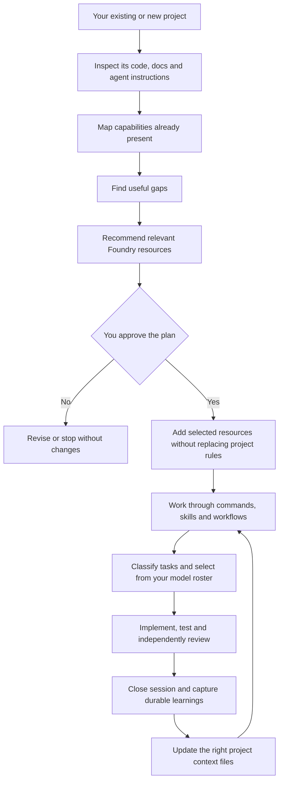
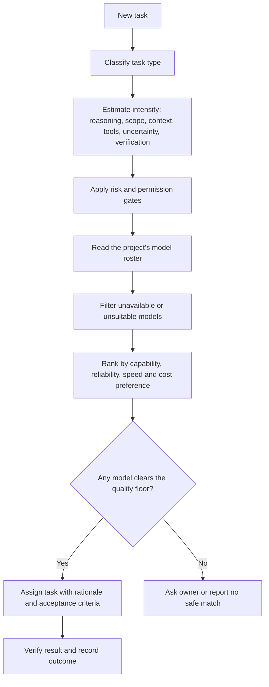

<div align="center">

# Agent Foundry

### A reusable engineering environment for AI coding agents.

Give your coding agent a consistent way to understand a project, plan work, delegate tasks, choose suitable models, verify changes and retain useful knowledge between sessions.

**One setup. A project-aware engineering system. Reusable across repositories.**

[](https://github.com/LemonizDev/Agent-Foundry/actions/workflows/ci.yml) [](LICENSE) [](https://nodejs.org/)

[Start here](#get-started) · [How it works](#how-it-works) · [Commands](#the-user-command-interface) · [Full user guide](docs/USER_GUIDE.md) · [Contributing](CONTRIBUTING.md) · [Support](SUPPORT.md)

</div>

---

## Why this exists

AI coding agents can write code. The harder problem is getting them to work reliably across a real project, over weeks or months, with changing requirements, multiple models and multiple sessions.

Without a shared operating system, every project ends up rebuilding the same things:

- Instructions explaining how the agent should inspect and modify a repository.
- A clear source of truth for architecture, decisions, roadmap and current progress.
- A way to split work between agents without losing accountability.
- A sensible method for choosing a model for each job.
- Repeatable testing, review, debugging and documentation practices.
- A way to preserve useful discoveries when a chat ends, without dumping the entire conversation into a handoff file.

The result is familiar: agents rediscover the same facts, repeat mistakes, use an oversized model for trivial tasks, use a weak model for difficult work, contradict earlier decisions, and sometimes announce completion without enough evidence.

**Agent Foundry is intended to solve the process and continuity problem around AI-assisted software development.**

It is an open-source resource library and project-integration CLI. It gives coding agents reusable engineering instructions, task procedures, commands, workflows, specialist role definitions and project-owned settings, then generates the host-specific files needed to expose those resources.

It does not replace the coding model or agent host. It does not guarantee correct code. It gives the host a better-defined way to work.

## What changes when a project uses it?

<details>
<summary><strong>Without a shared engineering system</strong></summary>

- Each new chat rediscovers project structure and conventions.
- Different agents follow different instructions.
- Delegation is ad hoc; assignments and checkpoints disappear.
- Model choice is often a fixed default rather than task-aware.
- Progress is reported from memory instead of verified evidence.
- Useful lessons remain buried in old conversations.
- Existing project instructions and new agent prompts gradually conflict.

</details>

<details>
<summary><strong>With Agent Foundry</strong></summary>

- The project has a compact entrypoint and clear authoritative context.
- Reusable procedures define how common engineering tasks are performed.
- Commands provide a predictable interface for recurring actions.
- Delegation considers task type, intensity, risk and the owner's model roster.
- Verification and reporting are evidence-based.
- Session close captures durable learnings in the correct context files.
- Installation is additive: existing architecture and instructions are preserved.

</details>

## How it works

Agent Foundry is organised around a project lifecycle, not around a pile of prompt files.



### The system has distinct parts

| Part | What it means in everyday language | Example |
|---|---|---|
| **Project context** | Facts about this particular software: what it does, how it is built, what decisions have been made and what is currently in progress | Architecture notes, roadmap, owner preferences |
| **Core instructions** | A short set of rules every agent working in the project should follow | Inspect before editing; preserve existing work; verify claims |
| **Commands** | Short requests the developer can invoke instead of explaining a recurring task each time | `/progress-report`, `/close`, `/settings` |
| **Skills** | Detailed instructions that teach the agent how to carry out a particular job | Debugging, session learning, model-aware delegation |
| **Workflows** | A coordinated sequence of jobs, decisions and checks | Integrate Foundry into an existing project |
| **Profiles** | Responsibility definitions for specialist agents | Lead engineer, independent reviewer, graphics engineer |
| **Standards and templates** | Shared quality rules and consistent formats for reports or records | Evidence requirements, test report template |
| **Settings and integrations** | Project-specific preferences and translations into the coding tool's supported format | User-defined model roster, host adapter |

The important distinction: **a command is the request, a skill is how to do the work, and a workflow is how several pieces of work fit together.** A model roster is configuration owned by the consuming project, not a universal list hardcoded into Agent Foundry.

## Get started

### The intended one-step experience

You should not need to clone this repository, download a ZIP or manually browse its folders.

1. Open the project you want to configure in your coding agent.
2. Give the agent the Agent Foundry link and the instruction below.
3. The agent inspects your project and identifies what you already have.
4. It recommends only relevant resources and shows you exactly what it plans to change.
5. You approve the plan; the agent integrates the resources.

Copy this into your coding agent:

> Initialise this project with Agent Foundry: https://github.com/LemonizDev/Agent-Foundry  
> Read BOOTSTRAP.md and bootstrap/INITIALIZE_PROJECT.md. Inspect my existing project, its architecture, documentation and agent instructions before making changes. Identify which capabilities I already have and which are missing. Recommend only relevant Agent Foundry resources, explain why each is useful, and show me the exact files you plan to create or modify. Preserve my existing architecture, instructions and local conventions. Do not overwrite anything. Wait for my approval before writing.

**Existing projects are first-class targets.** Foundry is supposed to integrate into an established codebase, not force the codebase to become a copy of one of its source projects.

[Read the complete setup procedure](BOOTSTRAP.md) · [Read the agent's initialization specification](bootstrap/INITIALIZE_PROJECT.md) · [Read the existing-project migration design](docs/architecture/EXISTING_PROJECT_INTEGRATION.md)

### What the installation is intended to look like

The installer adds only selected resources and the host-specific files needed to expose them. Existing source code, architecture and documentation remain where they are.

```text
your-project/
├── AGENTS.md                         # Created or extended with a marked Foundry pointer
├── CLAUDE.md                         # Created or extended when Claude Code is detected
├── .clinerules/agent-foundry.md      # Added when Cline is detected
├── .agents/skills/                   # Codex-compatible skills
├── .claude/skills/ and agents/       # Claude Code skills and specialist agents
├── .opencode/skills, commands, agents/
├── .kilo/skills, commands, agents/
├── .cline/skills/
├── docs/                              # Your existing project documentation
├── src/                               # Your existing source code
└── .agent-foundry/
    ├── manifest.json                 # Exact source commit and ownership hashes
    ├── instructions.md               # Compact project entrypoint
    ├── settings/
    │   ├── foundry-settings.yaml     # Project-owned policies
    │   └── model-roster.yaml         # Models YOU choose to make available
    ├── resources/                    # Selected canonical resources
    └── README.md                     # What was integrated and how to maintain it
```

The portable .agents/skills baseline is generated for Codex-compatible skill discovery. Additional host-specific folders are generated only when their host is detected. The exact installed file list is recorded in the manifest.

### Install with the CLI

Requirements: Node.js 20 or newer.

From the root of the target project, run:

```bash
npx --yes --package github:LemonizDev/Agent-Foundry agent-foundry init
```

This inspects the repository and prints a proposed resource plan. It does not change files.

After reviewing the plan, run:

```bash
npx --yes --package github:LemonizDev/Agent-Foundry agent-foundry init --preset auto --apply
```

The CLI asks for explicit confirmation. The auto preset starts with an autonomous-engineering baseline and adds visual QA resources when the project scanner detects graphics/rendering signals. You can choose minimal, balanced, autonomous-engineer, visual-engineer or research-engineer instead. The installer records ownership hashes in .agent-foundry/manifest.json and adds marked pointers without replacing existing content. If an existing project already has a resource at a target path, review the conflict and use --skip-conflicts to leave it untouched while installing the remaining resources.

Useful lifecycle commands:

```bash
npx --yes --package github:LemonizDev/Agent-Foundry agent-foundry inspect
npx --yes --package github:LemonizDev/Agent-Foundry agent-foundry validate
npx --yes --package github:LemonizDev/Agent-Foundry agent-foundry update
npx --yes --package github:LemonizDev/Agent-Foundry agent-foundry update --apply
npx --yes --package github:LemonizDev/Agent-Foundry agent-foundry uninstall
npx --yes --package github:LemonizDev/Agent-Foundry agent-foundry uninstall --apply
```

Updates and uninstall are preview-first. Updates stop on local modifications; uninstall removes only unchanged Foundry-owned files and preserves owner edits. The uninstall command requires typing `uninstall` before it changes files.

The CLI is an initial cross-platform implementation, not a stable release. Host file generation is tested, but native command discovery and execution still need validation inside each supported host. Model selection currently recommends from your roster; it does not dispatch provider calls or workers.
## The user command interface

The portable command contracts are the user-facing layer. The CLI now implements project lifecycle commands and a first-pass roster-based model recommendation. Native slash-command registration remains host-specific.

| Command | What it should do |
|---|---|
| `/progress-report` | Show verified project or milestone progress, evidence and the next action |
| `/teach-implementation` | Explain what changed, how it works and what to remember |
| `/close` | Capture useful project learnings from the current session into the correct context files |
| `/settings` | Show and edit project-level Agent Foundry settings |
| `/models edit` | Edit the model roster used for task-aware delegation |
| `/audit` | Map a repository and identify evidence-backed gaps |
| `/implement` | Execute a bounded, approved implementation plan |
| `/debug` | Reproduce and isolate a root cause |
| `/review` | Run an independent, findings-first code review |
| `/verify` | Verify acceptance criteria with explicit evidence |
| `/delegate` | Create a bounded model-aware worker assignment |
| `/next-task` | Recommend the highest-value next action |
| `/project-health` | Assess project health across engineering dimensions |
| `/resume` | Recover interrupted work from verified checkpoints |
| `/models explain` | Explain why a model is or is not suitable for a task |
| `/models test` | Run bounded capability checks on a configured model where host/provider support allows it |

CLI equivalents currently available: agent-foundry settings and agent-foundry route --task "describe the work". The latter classifies a task and ranks eligible models from the project's configured roster. It recommends; it does not dispatch a worker. The installer generates native command/skill files for detected hosts, but runtime discovery and execution still need host-by-host validation.

### Closing a session without losing what matters

The `/close` command is deliberately different from a conventional handoff generator.

It reviews the session for genuinely useful, durable information:
- new or clarified project requirements;
- stable coding and collaboration preferences;
- architectural decisions and their rationale;
- conventions discovered in the codebase;
- verified bugs, failure modes and their fixes;
- model or tool limitations supported by evidence.

It then updates the appropriate existing files: architecture docs, owner context, engineering instructions, troubleshooting guides, progress records or the model roster.

It does **not** save emotional content, conversational filler, speculative claims or a raw transcript. It does not create another generic `HANDOFF.md` by default.

The command prepares the project for the end of the session. Actually closing the chat window depends on whether the coding host exposes a supported chat-control API.

[Read the close-session design](commands/close-session.md)

## Task-aware model delegation

One model should not be used for every job.

A quick symbol lookup, a repetitive metadata edit, a complex root-cause investigation and a security review have different requirements. The delegation system classifies work before selecting a model.



Examples:
- **Fast lookup:** prefer a low-latency model that can reliably search and answer.
- **Mechanical edit:** prefer a smaller, faster model when the task is bounded and easy to verify.
- **Routine implementation:** require competent coding and tool use.
- **Complex debugging or architecture:** require stronger reasoning and sufficient context.
- **Security-critical work:** require strong reasoning plus independent verification.
- **Visual/runtime testing:** the model must have access to the relevant browser, renderer or device. Text intelligence alone is not enough.

The roster is defined by the project owner in `.agent-foundry/settings/model-roster.yaml`. Foundry does not hardcode a changing list of model names or assume that a model labelled “flash” is always suitable. The CLI's first-pass classifier is deliberately transparent and heuristic; use it as a routing aid, not an autonomous authority.

[Read the delegation architecture](docs/architecture/MODEL_DELEGATION.md) · [Edit-roster command contract](commands/edit-model-roster.md)

## Browse by the job you need done

You do not need to understand Foundry's internal categories to use it. Start with the task you're trying to accomplish:

| If you need to... | What Foundry provides |
|---|---|
| Make an agent understand how your project works | A project-context structure and compact global instructions that point to your actual architecture and decisions |
| Add AI agents to a project that already exists | A read-only assessment, capability map and approval-based additive integration plan |
| Split a large task between multiple agents | A delegation method with bounded assignments, file ownership, checkpoints, recovery and lead accountability |
| Choose a suitable model for each delegated task | A task classifier and a model roster that you control |
| See what is actually finished | Evidence-backed progress reporting that distinguishes implemented, tested, reviewed and still-unverified work |
| End a chat without losing useful discoveries | Session learning that updates the correct project context files instead of dumping a transcript |
| Keep project instructions from becoming contradictory | Source-of-truth and documentation governance rules |
| Review visual or graphics-heavy work | Visual regression, screenshot comparison, rendering probes and performance QA methods |
| Make agent execution safer | Permission boundaries, threat modelling, secret handling and verification gates |

Specific resources are available in the [resource registry](registry/resources.yaml). For a guided explanation, read the [User Guide](docs/USER_GUIDE.md).

## Where the practices came from

The first extraction sources are two real software projects:

### Dhan AI Trader
A long-running, multi-agent trading software project. Its reusable engineering practices include:
- specialist-agent responsibilities and bounded delegation;
- model-aware worker selection, assignment contracts and recovery;
- durable orchestration state, blockers and checkpoints;
- project governance, architecture decisions and source-of-truth documentation;
- security reviews, permission boundaries and independent verification;
- regression testing and evidence-backed progress reporting.

Trading strategy, broker rules, financial risk policy and other product-specific assumptions do not belong in Foundry's universal baseline.

### Rave Engine
A graphics-heavy, audio-reactive desktop wallpaper project built for the Lively Wallpaper platform. Its reusable practices include:
- creative direction translated into engineering acceptance criteria;
- specialist graphics, lighting and performance roles;
- visual probes, pinned-state captures and before/after comparison;
- testing that a visible setting actually reaches its runtime consumer;
- performance and soak testing with honest hardware/environment caveats;
- separating implementation, automated verification and actual visual inspection.

WebGL shaders, rave choreography, Lively-specific metadata, Windows utilities and hardware-specific thresholds remain project-specific.

The point is not to copy either codebase. It is to extract the engineering practices that can help other projects, then adapt them to each project's real needs.

[Source inventory](docs/audit/REUSABLE_RESOURCE_INVENTORY.md) · [Extraction decisions](docs/audit/EXTRACTION_DECISIONS.md) · [Extraction register](docs/EXTRACTION_REGISTER.md)

## Designed to work with different coding agents

The reusable method is kept separate from the tool-specific format. Different hosts expose different support for:
- root instruction files;
- skills and reference files;
- native commands or prompt shortcuts;
- subagents and per-agent model selection;
- persistent state and session control;
- shell, browser and filesystem permissions.

An integration must state which tool and version it supports, what it maps, what it cannot map, and how it was tested. A tool is not supported merely because it appears in a list of intended integrations.

## Project status

Agent Foundry is under active development. The resource library, first CLI installer and native artifact generators are in active development. Host runtime validation, automatic provider dispatch, signed release provenance and stable release processes remain outstanding.

| Capability | Status |
|---|---|
| Resource library and source provenance | In progress; resources remain drafts until validated |
| Agent-first bootstrap specification | Documented |
| Existing-project integration design | Documented |
| Session-learning and close command | Skill, command contract and host artifact generation implemented; chat UI closure depends on host APIs |
| Task-aware model selection | Heuristic classifier and user-roster selector implemented; provider dispatch not implemented |
| Native command/skill/profile file generation | Implemented for detected hosts; runtime validation pending |
| Project scanner, presets and plan-first CLI installer | Implemented in v0.4 branch; cross-platform CI pending |
| Hash-aware preview-first update and uninstall | Implemented in v0.4 branch; cross-platform CI pending |
| Registry, installer, model-router and host adapter tests | Implemented in v0.4 branch; cross-platform CI pending |
| Stable tagged release | Not yet available |

Do not treat a draft resource or documented design as a production-validated feature.

## Contributing

Useful contributions include:
- reusable skills with clear prerequisites and completion criteria;
- commands that have a clear user-facing purpose;
- workflows with explicit gates, ownership and recovery paths;
- tested coding-agent adapters;
- scenario tests and validation evidence;
- improvements to the onboarding guide.

See [resource authoring standards](docs/standards/RESOURCE_AUTHORING_STANDARD.md), the [documentation index](docs/README.md), the [Code of Conduct](CODE_OF_CONDUCT.md) and [Support](SUPPORT.md).

## Versioning and trust

The intended release model uses Semantic Versioning, immutable Git tags, GitHub Releases and a manifest that records the exact source commit. Local changes must be detected before updates. The stable release process, license, contribution policy, security policy and installer are still outstanding.

See [Distribution and Versioning](docs/architecture/DISTRIBUTION_AND_VERSIONING.md).

---

<div align="center">

**Agent Foundry**  
*Make your agent better at working on your project, not just better at generating code.*

</div>
