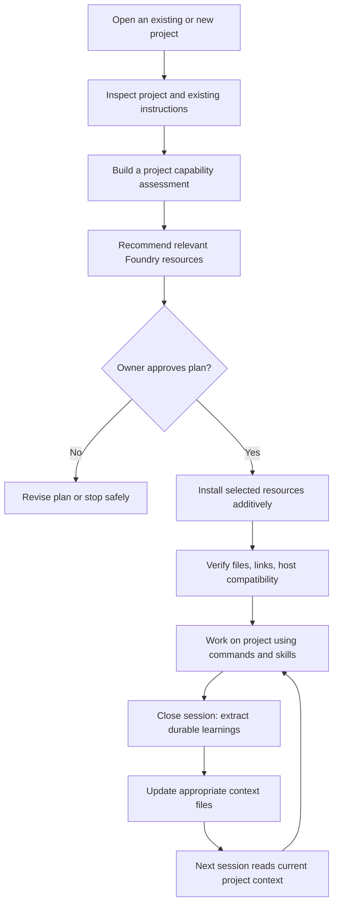

# Agent Foundry User Guide

This guide is for developers using Agent Foundry in a real project. It explains the intended operating model, the commands, how context is maintained, how model delegation works, and how to adopt Foundry without rebuilding an existing codebase.

> **Capability note:** Agent Foundry v0.4 includes a project-aware CLI, additive installer, manifest-based updates/uninstall, host-specific skill/command/profile file generation and a task-aware model recommendation engine. Host files are generated and unit-tested, but native command discovery and execution still require validation inside each supported host. The model router recommends from the owner roster; it does not dispatch providers or subagents. `/close` captures durable context but cannot close the chat UI unless the host exposes a supported API.

## 1. What problem does Agent Foundry solve?

An AI coding agent starts each project with incomplete knowledge. Even when it can read source files, it may not know:
- which files are authoritative;
- what the project is trying to achieve;
- how much autonomy it has;
- how work should be divided between agents;
- which model is suitable for a particular task;
- what evidence is required before declaring work complete;
- which decisions and user preferences should survive the end of a chat.

Without an explicit operating model, every new session spends time rediscovering these things. Different agents may also follow different practices, repeat failed approaches, overwrite useful context, or report activity as progress.

Agent Foundry packages reusable engineering practices and gives the project a consistent way to invoke them.

It is not a coding model, IDE, agent host, project-management replacement, or guarantee of correct output. The host still supplies the model, tools, permissions and execution environment. Foundry supplies the methods, context structure, command contracts and quality gates.

## 2. How the parts fit together

Think of the system as a small set of layers:

- **Project context** describes this particular product: purpose, architecture, constraints, current state and owner decisions.
- **Core instructions** tell every coding agent the small set of rules it must always follow.
- **Commands** are user-facing entry points such as `/close` or `/progress-report`.
- **Skills** contain the detailed procedure behind a command or task.
- **Workflows** coordinate multiple skills and agents across a sequence of work.
- **Profiles** define specialist responsibilities.
- **Model roster and settings** describe which models the owner has available and what they are good at.
- **Integrations** adapt these portable definitions to the syntax and capabilities of a particular agent host.

A command does not need to contain its entire procedure. It should route to a skill or workflow, which in turn references the project context and relevant standards.

## 3. Typical lifecycle



The goal is continuity without accumulating a transcript dump. The agent should preserve decisions and lessons that will change future work, not every conversation detail.

## 4. Initialising a project

### CLI installation

The initial CLI requires Node.js 20 or newer. From the target project root, run:

```bash
npx --yes --package github:LemonizDev/Agent-Foundry agent-foundry init
```

This inspects the project and prints a read-only installation plan. To apply the plan after reviewing it, run:

```bash
npx --yes --package github:LemonizDev/Agent-Foundry agent-foundry init --preset auto --apply
```

The CLI asks for explicit confirmation. Every preset and explicit resource selection includes the universal core baseline. Use `--skip-conflicts` to leave existing paths untouched and install the remaining resources. If the project is new and has no host configuration files to detect, pass the host explicitly, for example `--hosts kilo,cline` or `--hosts claude-code,opencode`.

Useful commands:

- `agent-foundry inspect` — inspect project structure, host signals and capability gaps.
- `agent-foundry list` — list available resources with descriptions.
- `agent-foundry validate` — validate installed files, settings and the model roster.
- `agent-foundry route --task TASK_DESCRIPTION` — classify a task and recommend a model from the project roster.
- `agent-foundry settings` — show project settings and model roster paths.
- `agent-foundry update` — preview updates; use `--apply` after reviewing.
- `agent-foundry uninstall` — preview removal; use `--apply` and type `uninstall` to confirm.

Updates and uninstall preserve owner-modified files. The installer records an immutable source commit and refuses path traversal or symlinked destinations. See [BOOTSTRAP.md](../BOOTSTRAP.md) for the complete procedure and limitations.


Use the instructions in [BOOTSTRAP.md](../BOOTSTRAP.md). The agent should inspect the project before proposing any changes.

The setup should work for:
- a brand-new repository with no agent instructions;
- an existing repository with AGENTS.md or another agent entrypoint;
- a mature repository with extensive documentation and established conventions;
- a project already using another agent framework;
- a project that already has some Foundry resources installed.

The agent must not assume that the target project needs every resource. It should detect equivalents, conflicts and gaps, then propose an additive installation.

### What the owner should see

Before any write, the owner should receive:
1. a short description of the project type detected;
2. existing instruction and context files discovered;
3. resources recommended, with a reason for each;
4. existing files that will be preserved;
5. proposed new files and any additive edits;
6. unsupported host capabilities and uncertainties;
7. the Foundry version and source revision.

The owner approves the plan before installation.

## 5. Choosing an installation preset

The CLI offers a few starting points. These are resource bundles, not rigid project architectures:

| Preset | Intended use |
|---|---|
| auto | Recommended default: autonomous-engineer baseline, plus visual QA resources when graphics/rendering signals are detected |
| minimal | Compact instructions, state management and evidence basics |
| balanced | Common engineering skills and commands without the full multi-agent campaign layer |
| autonomous-engineer | Delegation, model-aware assignments, campaign workflow, recovery and quality controls |
| visual-engineer | Autonomous-engineer baseline plus graphics, visual regression and performance QA resources |
| research-engineer | Research-oriented baseline with privacy-safe evidence and synthesis practices |

The scanner uses repository structure and manifest signals. These are heuristics, not a deep semantic understanding of the product. Review the installation plan and adjust the preset or explicit resource list before applying it.

## 6. Working with commands

Commands are named requests. Their exact invocation syntax depends on the host adapter. The portable contracts in `commands/` describe intent and behaviour.

Current command concepts include:

| Command | What it does |
|---|---|
| `/progress-report` | Produces an evidence-backed report of project or milestone progress |
| `/teach-implementation` | Explains a completed change in accessible language |
| `/close` | Consolidates durable session learnings into the right project context files |
| `/settings` | Shows and edits the project's Foundry preferences |
| `/models edit` | Opens the user-defined model delegation roster for editing |
| `/audit` | Audits repository structure and engineering capability gaps |
| `/implement` | Executes an approved implementation plan |
| `/debug` | Investigates a reproducible failure and its root cause |
| `/review` | Performs an independent findings-first review |
| `/verify` | Checks acceptance criteria against evidence |
| `/delegate` | Creates a bounded, model-aware assignment |
| `/next-task` | Selects the next high-value engineering action |
| `/project-health` | Assesses project health across multiple dimensions |
| `/resume` | Reconciles interrupted work and resumes from verified state |

A host that cannot register native slash commands can expose the same contracts as prompt shortcuts, named workflows, skills or documented natural-language triggers. Do not tell the owner a slash command is installed unless it actually is.

## 7. The close-session command

Use `/close`, `/close session` or `/close chat` when the useful work in a conversation is finished.

The command does not create a generic handoff document by default. It reviews the session for durable information and updates the existing source of truth:
- project purpose or requirements → product vision/context;
- architecture decisions → architecture document or decision register;
- stable owner preferences → owner context/preferences;
- implementation conventions → AGENTS.md or engineering standards;
- newly learned failure modes → relevant skill, runbook or troubleshooting guide;
- current milestone state → progress/roadmap;
- completed work → changelog;
- model capabilities or availability → model roster, with evidence and date.

Transient debugging output, emotional statements, speculation, repeated information and unverified claims are not durable learnings.

The agent must show a concise change summary, preserve history where appropriate, and verify edits. It must not close or claim to close the actual chat unless the host exposes a supported chat-control API. In most environments the command means “prepare this session to be safely ended”; the user closes the UI themselves.

See [Close Session](../commands/close-session.md) and the [session-close workflow](../workflows/session-close.md).

## 8. Model delegation and the model roster

Foundry does not ship a fixed universal list of model names. Providers, free tiers, model IDs, quotas and capabilities change. The project owner defines the available roster.

The router then:
1. classifies the task;
2. estimates its intensity and risk;
3. identifies required capabilities;
4. filters the owner-defined roster;
5. ranks eligible models against the task;
6. explains the selection and fallback;
7. reports the selection rationale and rejected candidates. Actual model benchmark results can be recorded by the owner after a bounded test; the router does not invent ratings or update the roster automatically.

A fast model is useful for latency-sensitive, bounded tasks. A smaller model can be ideal for simple mechanical work. Neither should be selected solely because it is cheap or labelled “flash”. High-impact architecture, security, data migrations and complex debugging require stronger reasoning and verification.

See [Model Delegation Architecture](architecture/MODEL_DELEGATION.md).

## 9. Keeping project context healthy

Do not put everything into AGENTS.md. Keep that file short enough to be read reliably. Link to the detailed project context and specialist resources.

A healthy project context normally includes:
- product vision and non-goals;
- architecture and important boundaries;
- current roadmap and progress;
- owner decisions and stable preferences;
- engineering and security constraints;
- operational runbooks where needed.

Each fact should have one authoritative home. Use references rather than copying the same rule into several files.

## 10. Updating an installation

The CLI compares the installed manifest with the selected Foundry registry revision. It checks hashes before changing files.

1. Run `agent-foundry update` to preview changed resources and conflicts.
2. Review the paths and versions.
3. Run `agent-foundry update --apply` and confirm to apply.
4. If any local modification is detected, the update stops rather than overwriting it. Resolve the conflict manually and rerun.

## 11. Uninstalling

1. Run `agent-foundry uninstall` to preview what will be removed and preserved.
2. Run `agent-foundry uninstall --apply`.
3. Type `uninstall` when prompted.

Uninstall removes only unchanged Foundry-owned resources and marked instruction blocks. It preserves locally modified resources, owner-edited settings and modified Foundry instruction files. Unchanged settings templates are removed. Review the preview before confirming.

## 12. Troubleshooting

**The host does not support slash commands.** Use the command contract as a natural-language instruction or install a verified host adapter.

**The host cannot spawn subagents.** Use the same assignment structure sequentially, or use an external orchestrator only if the owner has configured one.

**The host cannot choose a model per task.** The classifier can still recommend a model to the owner, but it must not claim automatic routing.

**The project already has extensive instructions.** Prefer integration and reconciliation. Do not replace them with Foundry defaults.

**A learning conflicts with an existing decision.** Do not silently rewrite the decision. Record the conflict and ask the owner to resolve it.

**A model's capability is unknown.** Mark it unknown and run a bounded evaluation before relying on it.

## 13. Current implementation status

The v0.4 branch includes a working Node.js CLI for inspection, presets, plan-first installation, host-native resource generation, manifest/hash tracking, settings validation, model recommendation, preview-first updates and uninstall. The source registry is pinned to an immutable commit SHA, and the installer includes rollback and path/symlink protections.

CI covers Node 20 and 22 on Ubuntu, Windows and macOS. Tests cover registry integrity, installer lifecycle, host artifact generation, model routing and canonical documentation links.

The remaining release gates are:
- verify native command discovery and execution inside each supported coding-agent host and document exact versions;
- validate command/profile behaviour with real host sessions, not only generated-file tests;
- add scenario-level tests for reusable skills and workflows;
- decide whether/when provider dispatch should be added as a separate, permissioned runtime;
- publish a tagged stable release only after those checks pass.

The current model router recommends a model from the owner's roster; it does not call providers or launch workers. The `/close` command captures durable project learning but cannot close a chat UI unless the host exposes a supported session-control API. Agent Foundry is not a sandbox.
