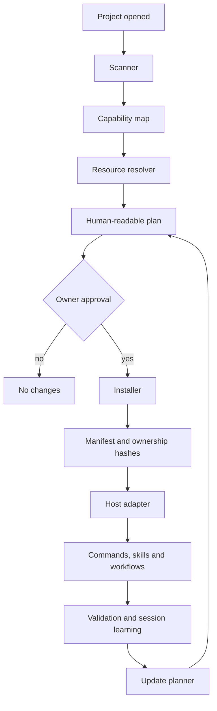

# Agent Foundry Engine Architecture

## Product boundary

Agent Foundry has three distinct planes:

1. **Resource plane:** versioned, provider-neutral commands, skills, workflows, profiles, standards and templates.
2. **Project plane:** a consuming repository's manifest, selected resources, settings, owner-defined model roster and project-specific overrides.
3. **Host plane:** adapters that map portable contracts into a coding agent's supported instruction, skill, command, tool and permission mechanisms.

The resource plane must not contain project secrets or a universal model roster. The project plane must not assume that every host supports subagents or model routing. The host plane must report capability gaps instead of pretending every abstraction maps cleanly.

## Lifecycle

## Core components

- **Scanner:** inventories project structure, existing agent instructions, documentation, test infrastructure and detected host signals. It is heuristic and must show its evidence.
- **Capability assessor:** classifies existing practices as keep/link/extend/install/adapt/defer/exclude. A file's existence alone is not proof of capability quality.
- **Source loader:** serves the registry and resource files from the installed package by default; explicit remote source selection resolves a ref to an immutable commit and fetches from that revision.
- **Registry:** declares resource IDs, types, versions, portability and dependencies.
- **Resolver:** selects requested resources and recursively includes declared dependencies.
- **Planner:** produces a preview of destinations and conflicts before writing.
- **Installer:** writes selected resources into the project-local Foundry directory, records hashes and adds a small pointer to the project's existing agent entrypoint. Uninstall prunes only directories made empty by removing Foundry-owned files.
- **Manifest:** records exact source revision, selected resources, installed paths and hashes so local changes can be detected.
- **Updater:** compares source and installed versions, preserving locally modified resources instead of overwriting them.
- **Validator:** checks manifest structure, resource presence, content hashes and required settings.
- **Host adapters:** map commands and resource loading to host-specific mechanisms; each adapter carries its own compatibility evidence.

## Trust and file ownership

Foundry owns only files explicitly recorded in its manifest and the exact marker block it inserts into AGENTS.md. It does not own the rest of AGENTS.md, project source code, user settings outside its directory or unrelated files.

Updates must not overwrite local modifications. Uninstall removes only unchanged resources whose hashes match the manifest and removes only the Foundry marker block. User-modified files are preserved and reported.

## Current implementation limits

The v0.5 CLI supports local inspection, project-aware presets, plan generation, approved installation, package-bundled source mode by default, explicit commit-pinned remote source mode, host-specific skill/command/profile generation, validation, preview-first updates and preview-first uninstall. The model router classifies tasks heuristically and recommends a model from the owner roster; it does not call providers or dispatch workers. Host file generation and CLI lifecycle are covered by automated tests, but command discovery and execution have not yet been exercised inside each host. Remote project scanning, autonomous provider dispatch, GUI configuration, signed registry manifests and full sandbox enforcement remain future work.
