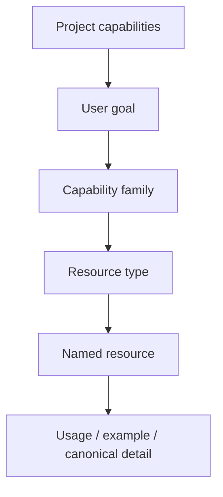
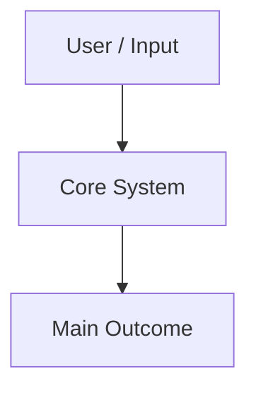

<!--
README TEMPLATE
This is a starting structure, not a compulsory checklist.
Inspect the repository, classify its purpose and maturity, and keep only
sections that help its real users. Replace all bracketed placeholders.
-->

<div align="center">

<!-- Optional project logo/banner with meaningful alt text -->
<!--  -->

# [Project Name]

### [One-sentence description of the project's main outcome.]

[Add only maintained status badges. Each badge must point to a real status source and target URL. Remove this note after adding valid badges.]

[Overview](#about-the-project) · [Features](#features) · [Architecture](#how-it-works) · [Install](#installation) · [Usage](#usage) · [Documentation](#documentation) · [Contribute](#contributing)

</div>

## Table of contents

- [About the project](#about-the-project)
- [Why it exists](#why-it-exists)
- [Features](#features)
- [How it works](#how-it-works)
- [Project status](#project-status)
- [Requirements](#requirements)
- [Installation](#installation)
- [Usage](#usage)
- [Configuration](#configuration)
- [Documentation](#documentation)
- [FAQ](#faq)
- [Contributing](#contributing)
- [Security and support](#security-and-support)
- [License](#license)

## About the project

[Explain what the project is, what it does, its intended users and the problem/domain it addresses. Avoid beginning with installation instructions or a list of tools.]

### Who is it for?

[Describe the main user groups and their goals.]

### What it is not

[Clarify boundaries or common misconceptions where useful.]

## Why it exists

[Explain the problem, the limitations of existing approaches, and the project's central idea. Use concrete examples rather than generic claims.]

## Features

[Show the most valuable user-facing capabilities. Prefer an illustrated overview or short list before exposing deep technical detail.]

## Feature menu

Use the Feature Menu Architect skill to inspect the project, classify user-goal families and resource kinds, and design the menu before filling it in. Do not copy a generic category list into every project.



<details>
<summary><strong>[Project-specific feature group]</strong></summary>

[One-sentence user goal and when this group is useful.]

<details>
<summary>[Resource family or type]</summary>

- **[Resource name]** — [short purpose]. [Canonical link]

</details>
</details>

[Include only groups supported by the repository inventory. Every public resource must either appear or have an explicit exclusion reason.]

## How it works

[Explain the system with a Mermaid diagram or screenshot when the architecture materially helps a newcomer.]



[Explain only the components and data flow needed to understand the diagram.]

## Project status

[State maturity, supported/released status, important known limitations, roadmap link and whether the project is production-ready. Do not imply support that has not been verified.]

## Requirements

[List runtime, OS/platform, dependencies, accounts, permissions and hardware prerequisites.]

## Installation

[Explain the supported installation paths. Collapse distinct platform/environment procedures when there are several.]

<details>
<summary><strong>[Installation option]</strong></summary>

```sh
[copyable commands]
```

[Explain expected output and how to verify success.]

</details>

## Usage

[Give one complete first-use example, with realistic input and expected output. Link to advanced usage/API references.]

```text
[example invocation]
```

[Expected result and next step.]

## Configuration

[Document configuration files, environment variables, safe defaults and links to the full reference. Never include real secrets.]

## Documentation

| Need | Resource |
|---|---|
| Getting started | Replace with a relative link to the canonical getting-started guide. |
| Architecture | Replace with the canonical architecture document. |
| API/reference | Replace with the canonical API reference. |
| Operations/troubleshooting | Replace with the canonical runbook or troubleshooting guide. |

## FAQ

<details>
<summary>[Question users are likely to ask]</summary>

[Concise evidence-based answer.]

</details>

## Contributing

[Explain the contribution process, current community status, contribution guide and code of conduct.]

## Security and support

[Link to security policy, support channels and issue reporting.]

## License

[State the license and link to the license file.]

---

[Back to top](#project-name)
